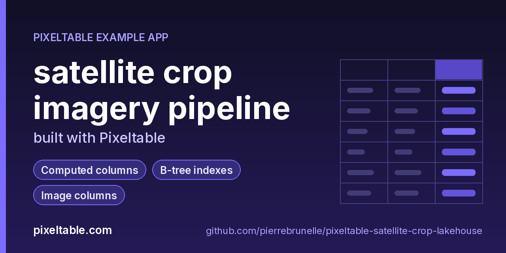

<!-- pixeltable-example-app: 20261116-satellite-crop-lakehouse -->
# Build a multimodal data pipeline that exports to a lakehouse in Python

Store satellite images and their metadata in one Pixeltable table, add computed columns for the scores you need, and call export_parquet, export_iceberg or export_lancedb to hand the same data to a lakehouse. This example does it for crop tiles in about 150 lines of Python.

**Replaces:** Spark jobs + S3 folders + a feature store



[](https://codespaces.new/pierrebrunelle/pixeltable-satellite-crop-lakehouse?quickstart=1)
[](https://pixeltable.com)
[](https://pypi.org/project/pixeltable/)
[](https://github.com/pixeltable/pixeltable)
[](LICENSE)

An agronomy team receives small RGB satellite tiles per field. Pixeltable stores the images next to their metadata in one table, scores each tile incrementally with computed columns (greenness, health band, thumbnail), and exports the same data to three lakehouse formats: Parquet (with and without inline image bytes), Apache Iceberg through a SQLite-backed catalog, and LanceDB. Several writer threads load tiles in parallel and the script prints timings. It replaces a pile of Spark jobs, S3 folders and a feature store with one Python script. No web server.

[Pixeltable](https://pixeltable.com) is open-source, Python-native **multimodal AI data infrastructure**: tables, incremental computed columns, UDFs, indexes and serving in one library, running locally or on Pixeltable Cloud.

> ⭐ **Like this example?** Star [pixeltable/pixeltable](https://github.com/pixeltable/pixeltable) on GitHub. It helps other developers find it.

## What this example shows

- **Incremental computed columns** powered by plain Python UDFs (`@pxt.udf`)
- **B-tree indexes** declared on the model (`__indexes__`) back the lookup queries
- **Multimodal media columns** with configurable media destinations
- **Importable UDF module**: UDFs live in `udfs.py`; tables and queries live in `app.py` (Pixeltable resolves UDFs by module path)
- **`pixeltable.toml`** declares a local database and a **Pixeltable Cloud** database, so the same code deploys with `pxt db update`


## What's inside

| File | What it is |
|------|------------|
| `.devcontainer/devcontainer.json` | GitHub Codespaces / Dev Container config: Python 3.12, installs `requirements.txt` |
| `.github/social-preview.png` | Social preview image (1280x640) |
| `CITATION.cff` | Citation metadata (authors, license, release date, keywords) |
| `app.py` | Tables declared as Python classes and `@pxt.query` functions |
| `data/tiles.json` | Sample data |
| `data/tiles/tile_000.png` | Sample data |
| `data/tiles/tile_001.png` | Sample data |
| `data/tiles/tile_002.png` | Sample data |
| `data/tiles/tile_003.png` | Sample data |
| `data/tiles/tile_004.png` | Sample data |
| `data/tiles/tile_005.png` | Sample data |
| `data/tiles/tile_006.png` | Sample data |
| `data/tiles/tile_007.png` | Sample data |
| `data/tiles/tile_008.png` | Sample data |
| `data/tiles/tile_009.png` | Sample data |
| `data/tiles/tile_010.png` | Sample data |
| `data/tiles/tile_011.png` | Sample data |
| `data/tiles/tile_012.png` | Sample data |
| `data/tiles/tile_013.png` | Sample data |
| `data/tiles/tile_014.png` | Sample data |
| `data/tiles/tile_015.png` | Sample data |
| `data/tiles/tile_016.png` | Sample data |
| `data/tiles/tile_017.png` | Sample data |
| `data/tiles/tile_018.png` | Sample data |
| `data/tiles/tile_019.png` | Sample data |
| `data/tiles/tile_020.png` | Sample data |
| `data/tiles/tile_021.png` | Sample data |
| `data/tiles/tile_022.png` | Sample data |
| `data/tiles/tile_023.png` | Sample data |
| `data/tiles/tile_024.png` | Sample data |
| `data/tiles/tile_025.png` | Sample data |
| `data/tiles/tile_026.png` | Sample data |
| `data/tiles/tile_027.png` | Sample data |
| `data/tiles/tile_028.png` | Sample data |
| `data/tiles/tile_029.png` | Sample data |
| `data/tiles/tile_030.png` | Sample data |
| `data/tiles/tile_031.png` | Sample data |
| `data/tiles/tile_032.png` | Sample data |
| `data/tiles/tile_033.png` | Sample data |
| `data/tiles/tile_034.png` | Sample data |
| `data/tiles/tile_035.png` | Sample data |
| `data/tiles/tile_036.png` | Sample data |
| `data/tiles/tile_037.png` | Sample data |
| `data/tiles/tile_038.png` | Sample data |
| `data/tiles/tile_039.png` | Sample data |
| `data/tiles/tile_040.png` | Sample data |
| `data/tiles/tile_041.png` | Sample data |
| `data/tiles/tile_042.png` | Sample data |
| `data/tiles/tile_043.png` | Sample data |
| `data/tiles/tile_044.png` | Sample data |
| `data/tiles/tile_045.png` | Sample data |
| `data/tiles/tile_046.png` | Sample data |
| `data/tiles/tile_047.png` | Sample data |
| `make_data.py` | Generate small synthetic RGB crop tiles under data/tiles/ plus data/tiles.json (metadata) |
| `pipeline.py` | Satellite crop tiles batch pipeline (no HTTP service) |
| `pixeltable.toml` | Project config: the local database plus a Pixeltable Cloud database (sizing, deploy excludes) |
| `udfs.py` | Pixeltable UDFs (`@pxt.udf`) in their own importable module, imported by `app.py` |
| `requirements.txt` / `pyproject.toml` | Dependencies (`pixeltable>=0.7.24`) |

**Tables**

| Table | Stored columns | Computed columns |
|-------|---------|------------------|
| `tiles` | `tile_id`, `field_id`, `region`, `captured_on`, `image` | `green`, `health`, `thumb` |

## Run in your browser (GitHub Codespaces)

[](https://codespaces.new/pierrebrunelle/pixeltable-satellite-crop-lakehouse?quickstart=1)

1. Click **Open in GitHub Codespaces** above (or [this link](https://codespaces.new/pierrebrunelle/pixeltable-satellite-crop-lakehouse?quickstart=1)). The dev container installs Python 3.12 and `pixeltable>=0.7.24` from `requirements.txt`.
2. In the codespace terminal, create the tables, seed them and run the app:

   ```bash
   pxt schema update app.py satellite
   pip install -U 'pixeltable[serve]' 'pyiceberg[sql-sqlite]' lancedb pylance pillow
   python make_data.py
   pxt schema update app.py crops
   python pipeline.py --writers 4 --batch 6
   ls out/  # tiles_parquet, tiles_parquet_images, iceberg, lance
   ```


## Quickstart

Requires Python 3.11+ and `pixeltable>=0.7.24`.

```bash
git clone https://github.com/pierrebrunelle/pixeltable-satellite-crop-lakehouse.git
cd pixeltable-satellite-crop-lakehouse
python -m venv .venv && source .venv/bin/activate
pip install -r requirements.txt

# Create the tables in a local catalog directory named `satellite`
pxt schema update app.py satellite

pip install -U 'pixeltable[serve]' 'pyiceberg[sql-sqlite]' lancedb pylance pillow
python make_data.py
pxt schema update app.py crops
python pipeline.py --writers 4 --batch 6
ls out/  # tiles_parquet, tiles_parquet_images, iceberg, lance
```

## Deploy to Pixeltable Cloud

The same `app.py` runs on [Pixeltable Cloud](https://pixeltable.com). Sign in (or get a free trial database with `pxt new`), point the second database entry in `pixeltable.toml` at your own database, then deploy:

```bash
pxt login                       # or: export PIXELTABLE_API_KEY=<your-api-key>
# edit pixeltable.toml: name = 'pxt://<your-org>:<your-db>'
pxt db update pxt://<your-org>:<your-db>                 # build the image and upload the project
pxt schema update app.py pxt://<your-org>:<your-db>       # create the tables at the database root (no per-app folder)
```

Keep keys in environment variables or `pxt secret set`, never in code.

## Code walkthrough

**1. Business logic is plain Python, in `udfs.py`.** A `@pxt.udf` function can be used as a column expression. Pixeltable records UDFs by module path (`udfs.greenness`), so they live in their own importable module rather than inline in the app: the daemon, serving workers and Pixeltable Cloud import it again by that path.

```python
# udfs.py
@pxt.udf
def greenness(img: PIL.Image.Image) -> float:
    """Excess-green index of a tile, scaled 0..1 (a cheap NDVI stand-in for RGB-only tiles)."""
    small = img.convert('RGB').resize((32, 32))
    px = list(small.getdata())
    exg = sum(2 * g - r - b for r, g, b in px) / (len(px) * 255.0)
    return max(0.0, min(1.0, (exg + 1.0) / 2.0))
```

**2. Tables are Python classes (`app.py`).** Annotated attributes are stored columns; attributes assigned an expression are **computed columns** (`green`, `health`, `thumb`), evaluated incrementally on every insert or update and recomputed when their inputs change. Indexes live next to the columns.

```python
# app.py
class Tiles(TableModel, name='tiles', has_default_idxs=False):
    """One satellite tile (RGB image) for a field and capture date."""

    tile_id = pxt.Column(type=pxt.String, primary_key=True)
    field_id: pxt.String
    region: pxt.String
    captured_on: pxt.Date
    image: pxt.Image

    width = image.width
    height = image.height
    green = greenness(image)
    health = crop_health(green)
    thumb = pxtf.image.resize(image, (64, 64))

    __indexes__ = [pxt.BtreeIndex(field_id), pxt.BtreeIndex(region)]
```

**3. Queries are functions (`app.py`).** `@pxt.query` wraps a Pixeltable query so it can be called from Python or exposed as a route:

```python
# app.py
@pxt.query
def stressed_fields(region: str, max_green: float):
    """Tiles in a region whose greenness is at or below a threshold, worst first."""
    return (
        Tiles.where((Tiles.region == region) & (Tiles.green <= max_green))
        .order_by(Tiles.green)
        .select(Tiles.tile_id, Tiles.field_id, Tiles.captured_on, Tiles.green, Tiles.health)
    )
```

## FAQ

**How do I export a Pixeltable table to Apache Iceberg?**

Create a pyiceberg catalog (this example uses a SQLite-backed SqlCatalog), then call pxt.io.export_iceberg(table_or_query, catalog, 'namespace.table', if_exists='replace').

**Can I export images, not just metadata?**

Yes. export_lancedb accepts image columns directly, and export_parquet writes image bytes when you pass inline_images=True.

**Is this a LanceDB alternative?**

Pixeltable manages the images, computed columns and incremental updates, and can export to LanceDB, Iceberg or Parquet when a downstream system needs them.

**Can several processes load data at the same time?**

Yes. The pipeline runs parallel writer threads, each inserting its own batch; inserting the same primary key twice raises a duplicate-key error, so filter existing ids first as the script does.

## Learn more

- 🌐 Website: https://pixeltable.com
- 📚 Docs: https://docs.pixeltable.com
- 💻 Source: https://github.com/pixeltable/pixeltable (⭐ star it if Pixeltable is useful to you)
- 📦 PyPI: https://pypi.org/project/pixeltable/
- 🧩 More example apps: https://pierrebrunelle.github.io/awesome-pixeltable-apps/

**[More Pixeltable example apps →](https://pierrebrunelle.github.io/awesome-pixeltable-apps/)**

---

<sub>Built as part of a daily series of Pixeltable example apps · Pixeltable 0.7.24 · Python, incremental computed columns · Licensed under Apache-2.0.</sub>
